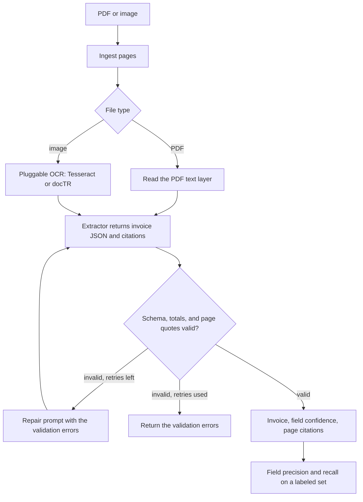

# Document AI extraction

[](https://github.com/applycoding/document-ai-extraction/actions/workflows/ci.yml)

Pipeline demo that turns a PDF or image into a validated invoice (or a receipt with the same fields), with a page citation and a confidence for each field.

## Honest demo note

This is a portfolio demo of the pipeline, not a production document system.

- The labeled files in `data/synthetic` are generated invoices and receipts. Vendors, amounts, and dates are fictional. There is no personal data.
- CI and the default CLI use a deterministic template parser. They do not call a hosted model, and they do not download OCR weights.
- Tesseract and docTR are optional adapters. A scanned PDF is rejected: this demo reads a PDF text layer and OCRs images, and it does not rasterize PDF pages.
- Parser confidences are fixed heuristics. A live model's confidences are whatever the model returns. Neither is a calibrated probability.
- Precision and recall are whatever `document-ai eval` prints for the dataset you give it. This README does not publish a score.

## Pipeline



The extractor is pluggable. `parser` reads the synthetic template offline. `openai` posts to an OpenAI-compatible chat endpoint. Tests use `FakeLLM`, which replays scripted strings, including invalid JSON that the repair loop has to correct.

## Quick start

```bash
python -m venv .venv
source .venv/bin/activate
pip install -e ".[dev,server]"

document-ai eval --dataset data/synthetic
document-ai extract data/synthetic/inv_001.pdf
uvicorn document_ai.api:app --reload
```

Extraction of the committed PDFs works with the default `--llm parser` and does not need an OCR binary. The eval command prints field-level counts and precision, recall, and F1. Copy figures from that output if you need them.

```bash
curl -s -F "file=@data/synthetic/inv_001.pdf" http://127.0.0.1:8000/v1/extract
```

`GET /health` returns `{"status": "ok"}`. `POST /v1/extract` accepts a multipart field named `file` (10MB max).

## CLI

```bash
document-ai extract invoice.pdf --llm parser --ocr tesseract --max-retries 2
document-ai extract scan.png --ocr tesseract
document-ai eval --dataset data/synthetic --out eval_report.json
document-ai generate-dataset --out data/synthetic --count 8
```

`--llm openai` reads `OPENAI_API_KEY`, and optionally `OPENAI_BASE_URL`, `OPENAI_MODEL`, and `OPENAI_JSON_MODE=0`. The API process uses `DOCUMENT_AI_LLM` (default `parser`), `DOCUMENT_AI_OCR` (default `tesseract`), and `DOCUMENT_AI_MAX_RETRIES`.

## What is validated

The model must return JSON matching `CitedExtraction`: an `Invoice` plus one citation per field. Pydantic checks:

- currency is three uppercase letters
- each line amount is quantity times unit price, within one cent
- subtotal matches the line amounts, and total matches subtotal plus tax, within one cent
- `due_date`, when present, is not earlier than `invoice_date`

After that, each citation must point at a real page, and its quote must appear in that page's text. A failure sends the error text back to the extractor, up to `--max-retries` extra attempts. Overall confidence is the mean of the field confidences.

Field paths look like `vendor_name` or `line_items[0].amount`.

## OCR extras

```bash
# System package tesseract-ocr, then:
pip install -e ".[ocr-tesseract]"

# Downloads pretrained weights on first use:
pip install -e ".[ocr-doctr]"
```

## Evaluation

Labels are the invoice JSON next to each PDF. Header fields are compared one slot at a time. A wrong value counts as a false positive and a false negative. Line items are matched greedily by description, then quantity, unit price, and amount are scored on the pair. Money is compared at cent precision.

Unreadable documents count as misses for every gold field, and the command exits 1. The printed table and the optional JSON report are the measurement.

Regenerate the committed set with `document-ai generate-dataset --out data/synthetic --count 8`. Every fifth document is a receipt. Every fourth document puts the totals on page 2.

## Tests

GitHub Actions runs `ruff check` and `pytest` on Python 3.11. The tests use `FakeLLM`, `FakeOCR`, and a stubbed HTTP client. They do not need API keys, Tesseract, or docTR.

## Layout

```text
src/document_ai/          pipeline, FastAPI app, CLI
src/document_ai/ocr/      Tesseract, docTR, and fake OCR
src/document_ai/llm/      parser baseline, OpenAI-compatible client, fake LLM
src/document_ai/dataset/  synthetic invoice generator
src/document_ai/eval/     field precision and recall
data/synthetic/           committed fictional PDFs and labels
tests/                    unit tests
```

## License

MIT, copyright Arpan Bom.
